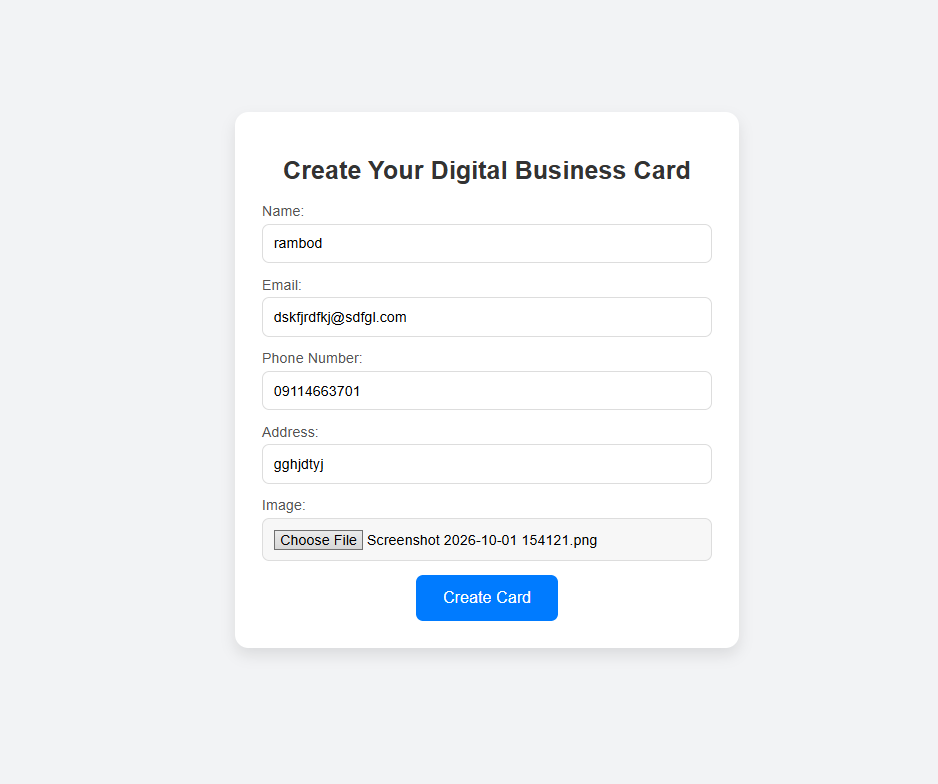
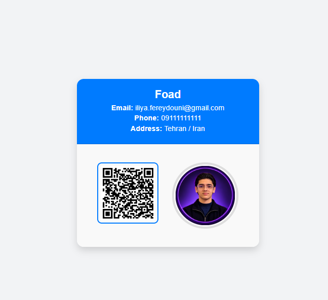

# 💳 کارت ویزیت دیجیتال با QR Code

یک پروژه تحت وب برای ساخت کارت ویزیت دیجیتال با استفاده از PHP و MySQL.

با استفاده از این پروژه، کاربران می‌توانند کارت ویزیت دیجیتال اختصاصی خود را ایجاد کنند، اطلاعات تماس و تصویر پروفایل خود را ثبت کنند و یک QR Code اختصاصی دریافت کنند تا دیگران بتوانند به‌راحتی با اسکن آن، کارت ویزیتشان را مشاهده کنند.

## ✨ امکانات پروژه

- ایجاد کارت ویزیت دیجیتال اختصاصی
- ثبت نام و اطلاعات تماس شامل ایمیل، شماره تلفن و آدرس
- امکان آپلود تصویر پروفایل
- تولید خودکار QR Code اختصاصی برای هر کارت
- ذخیره اطلاعات در پایگاه داده MySQL
- ایجاد لینک اختصاصی برای هر کارت ویزیت
- نمایش اطلاعات کارت با اسکن QR Code
- امکان اجرای پروژه به‌صورت لوکال با XAMPP

## 🖼️ تصاویر پروژه

در این بخش می‌توانید بخش‌های مختلف پروژه را مشاهده کنید.


### فرم ساخت کارت ویزیت



### کارت ویزیت دیجیتال




## 🛠️ تکنولوژی‌های استفاده‌شده

| تکنولوژی | کاربرد |
|---|---|
| PHP | توسعه بخش بک‌اند |
| MySQL | مدیریت و ذخیره اطلاعات |
| HTML5 | ساختار صفحات |
| CSS3 | طراحی رابط کاربری |
| Composer | مدیریت وابستگی‌ها |
| Endroid QR Code | تولید QR Code |
| XAMPP | محیط اجرای لوکال |

## ⚙️ پیش‌نیازها

برای نصب و اجرای پروژه به موارد زیر نیاز دارید:

- PHP نسخه 8.2 یا بالاتر
- MySQL
- Apache
- Composer
- افزونه GD فعال در PHP

برای راه‌اندازی آسان‌تر، استفاده از نرم‌افزار XAMPP پیشنهاد می‌شود.

## 🚀 نصب و راه‌اندازی

### ۱. دریافت پروژه

ابتدا مخزن را با دستور زیر دریافت کنید:

```bash
git clone https://github.com/YOUR-USERNAME/YOUR-REPOSITORY.git
```

### ۲. انتقال پروژه به XAMPP

پوشه پروژه را داخل مسیر `htdocs` در محل نصب XAMPP قرار دهید.

### ۳. نصب وابستگی‌ها

ترمینال را در پوشه اصلی پروژه باز کنید و دستور زیر را اجرا کنید:

```bash
composer install
```

### ۴. راه‌اندازی دیتابیس

ابتدا Apache و MySQL را از طریق XAMPP اجرا کنید.

سپس وارد phpMyAdmin شوید:

```text
http://localhost/phpmyadmin
```

یک دیتابیس با نام زیر ایجاد کنید:

```text
business_card
```

سپس از طریق تب **Import**، فایل دیتابیس موجود در پروژه را انتخاب و وارد کنید.

### ۵. تنظیم اتصال دیتابیس

اطلاعات اتصال به MySQL را در فایل‌های مربوط به اتصال دیتابیس مطابق تنظیمات سیستم خود وارد کنید.

تنظیمات پیش‌فرض XAMPP معمولاً به شکل زیر است:

```php
$host = 'localhost';
$db = 'business_card';
$user = 'root';
$password = '';
```

### ۶. فعال‌سازی افزونه GD

برای تولید تصاویر QR Code، افزونه GD باید در PHP فعال باشد.

در فایل `php.ini` خط زیر را پیدا کنید:

```ini
;extension=gd
```

علامت `;` ابتدای خط را حذف کنید:

```ini
extension=gd
```

سپس Apache را Restart کنید.

### ۷. اجرای پروژه

مرورگر خود را باز کنید و آدرس زیر را وارد کنید:

```text
http://localhost/YOUR-PROJECT-FOLDER/
```

اکنون پروژه آماده استفاده است!

## 📌 نحوه عملکرد

۱. کاربر اطلاعات موردنیاز خود را وارد می‌کند.

۲. تصویر پروفایل خود را آپلود می‌کند.

۳. اطلاعات در پایگاه داده ذخیره می‌شوند.

۴. یک QR Code اختصاصی برای کارت ویزیت ایجاد می‌شود.

۵. کاربر می‌تواند کارت ویزیت دیجیتال خود را مشاهده و لینک یا QR Code آن را با دیگران به اشتراک بگذارد.

۶. سایر افراد با اسکن QR Code به صفحه اختصاصی کارت ویزیت دسترسی پیدا می‌کنند.

## 📄 مجوز استفاده

این پروژه به‌صورت عمومی در GitHub منتشر شده است و می‌توانید کدهای آن را بررسی کنید، تغییر دهید و برای یادگیری یا توسعه پروژه‌های خود از آن استفاده کنید.

---

**ساخته‌شده با PHP و MySQL ❤️**